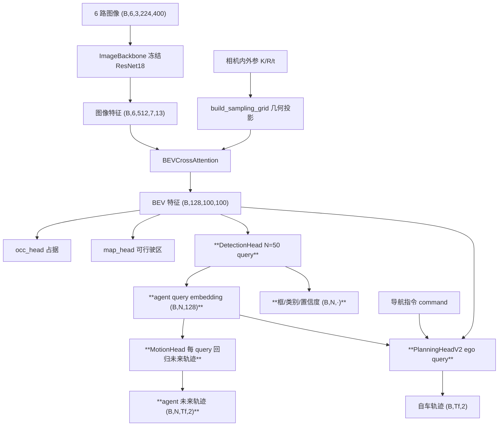
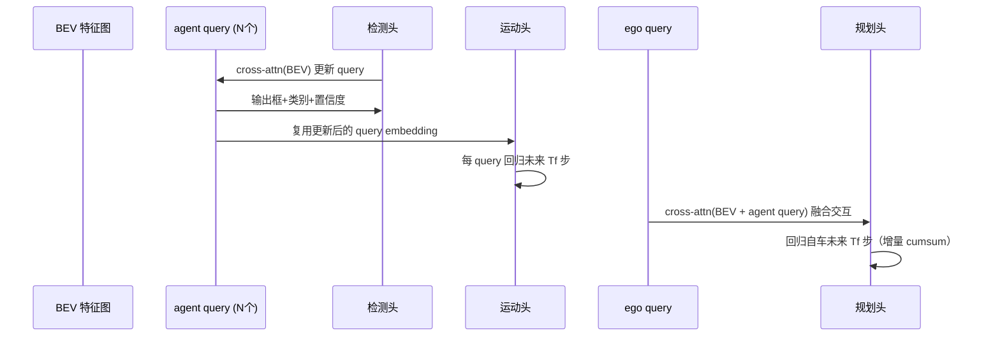

# 设计文档：nano-fsd-v2 — 对齐 UniAD 的「五脏俱全」端到端自动驾驶

## 概述

v2 已经搭起「图像 → BEV → 规划」的真实感知闭环：6 路环视图经冻结 ResNet-18 提特征，
用几何引导的 cross-attention 投影成稠密 BEV 特征图，再接三个密集头（规划轨迹、占据
栅格、可行驶区分割）。但相比 UniAD，v2 缺了**个体化的目标级感知与交互**：没有检测/
跟踪出一个个 agent，没有预测每个 agent 的未来运动，规划头也只从 BEV 全局池化读信息，
看不见具体的某辆车要往哪走。

本设计在**不推翻现有 BEV 栈**的前提下，补齐 UniAD 的三个核心「脏器」，让项目做到
「麻雀虽小五脏俱全」，同时严格控制在单卡 24G 可训规模内：

1. **检测/跟踪头（DetectionHead）** — query-based，N 个可学习 agent query 去 attend
   BEV 特征，输出每个 query 的框（中心/尺寸/朝向）+ 类别（2 类：车/人）+ 存在置信度。
   对齐 UniAD 的 TrackFormer（简化：本版只做单帧检测，query 复用但不跨帧传播，称「检测头」）。
2. **运动预测头（MotionHead）** — 每个 agent query 回归该 agent 的未来轨迹（Tf 步），
   对齐 UniAD 的 MotionFormer（简化：直接从 agent query 的 embedding 回归，不做多模态/
   不做 agent-agent 的二次 attention）。
3. **交互式规划头（PlanningHeadV2）** — ego query 去 attend（BEV + agent query），
   让自车轨迹的生成能「看见」周围 agent 的位置与预测运动，对齐 UniAD 规划阶段的
   agent/map 交互（简化：标准 cross-attention，不含碰撞代价优化层）。

贯穿三头的主线是 UniAD 的核心思想——**query 作为跨任务的信息载体**：同一批 agent
query 先在检测头拿到「我是谁、在哪」，再在运动头产出「我要去哪」，最后作为 K/V 被
规划头消费。这条 query 主线是本次迭代最重要的学习点。

### 设计目标与非目标

**目标**
- 补齐目标级检测、运动预测、交互式规划三个头，形成 UniAD 式的 query 贯穿管线。
- 全程可在单卡 24G 训练（N=50 query，沿用 BEV 100×100、冻结 backbone）。
- 分步可验证：数据 → 检测头 → 运动头 → 规划头，每步独立跑通并出可视化。
- 保持学习导向：每步讲清输入/输出/原理，与 UniAD 的对应关系标注清楚。

**非目标**
- 不追求 SOTA 指标，不实现完整 BEVFormer（deformable attention）、不做时序 BEV 融合。
- 不做严格匈牙利匹配（用简化的「预测到 GT 最近距离」贪心匹配）。
- 不做多模态轨迹预测、不做显式碰撞代价/占据代价的规划优化层。
- 不改动已验证的图像 backbone 与 BEV cross-attention 几何。

### 与 UniAD 的对应关系（学习锚点）

| UniAD 模块 | 本设计对应 | 简化点 |
|-----------|-----------|--------|
| BEVFormer | BEVCrossAttention（已有） | 标准注意力代替 deformable，无时序融合 |
| TrackFormer | DetectionHead | 仅单帧检测，query 不跨帧传播 |
| MapFormer | map_head（已有，可行驶区） | 仅可行驶区分割，无矢量化车道线 |
| MotionFormer | MotionHead | 从 query 直接回归，无多模态/无 agent 间二次交互 |
| OccFormer | occ_head（已有，占据栅格） | 稠密 BCE，无实例级占据 |
| Planner | PlanningHeadV2 | cross-attention 交互，无碰撞代价优化 |

## 架构

### 整体数据流（新增部分加粗）



### query 主线时序（UniAD 核心思想）



### 关键设计决策

**决策 1：query-based 检测（方案 B），而非 BEV 栅格直接出框**
- 选择：N=50 个可学习 agent query，经 Transformer decoder 层 attend BEV 特征，每 query
  出一个候选目标。对齐 UniAD/DETR 的 set prediction 范式。
- 理由：query 是 UniAD 贯穿检测→运动→规划的载体；用 query 能把「同一个 agent 的身份」
  自然带到下游头，这是本次学习的核心。栅格出框（如 CenterPoint 风格）无法自然承接下游
  query 交互。
- 代价：需要「预测-GT 匹配」才能算 loss（下决策 2）。

**决策 2：简化匹配（最近距离贪心），而非严格匈牙利**
- 选择：每帧把 N 个预测框中心与 M 个 GT 框中心算距离矩阵，为每个 GT 贪心指派最近且未被
  占用的预测 query（M≤N）；未匹配的 query 作为「背景/无物体」负样本。
- 理由：匈牙利（线性指派）更优但实现与讲解成本高；最近距离贪心足够让学习信号成立，且
  便于理解「哪个 query 负责哪个 GT」。标注为简化点，后续可替换为 `scipy.linarg`/匈牙利。
- 风险：贪心可能次优匹配，训练略不稳；用置信度 + 距离阈值缓解。

**决策 3：MotionHead 从 query embedding 直接回归，不做二次 attention**
- 选择：检测头输出的每个 agent query embedding (B,N,128) 过一个 MLP 回归 (B,N,Tf,2) 的
  未来相对轨迹（相对该 agent 当前框中心）。
- 理由：UniAD 的 MotionFormer 还会让 agent 彼此 attend（agent-agent 交互）+ 多模态。
  本版先用最简单的「每 query 独立回归单模态」跑通链路，把多模态/交互列为后续增强。
- 对齐锚点：讲清 UniAD 为什么要 agent 间交互（博弈/避让），本版省略的后果（预测偏独立）。

**决策 4：PlanningHeadV2 用 ego query attend（BEV + agent query），替换全局池化**
- 选择：新增 1 个可学习 ego query，先 attend BEV（看道路/占据），再 attend agent query
  （看周围车要去哪），融合导航 command embedding，回归自车未来增量轨迹（cumsum）。
- 理由：现规划头只做 BEV 全局平均池化，丢失了「具体哪辆车在哪」的空间信息；UniAD 规划
  显式与 agent/map 交互。改成 cross-attention 让规划「看得见」个体 agent。
- 兼容：保留旧 PlanningHead 作为对照（可通过开关切换），便于学习对比两种规划头效果。

**决策 5：数据侧新增「结构化 agent 列表」，复用现有占据生成的框解析**
- 选择：在 `build_meta_cache.py` 为每帧额外缓存 GT agent 列表：每个 agent 的中心 (x,y)、
  朝向 yaw、尺寸 (w,l)、类别 id、未来轨迹 (Tf,2) + mask。沿用已验证的 global→ego 变换。
- 理由：现缓存只有占据栅格（稠密），没有「一个个 agent」的结构化信息，检测/运动头的
  监督无从谈起。需要重建缓存（新字段，向后兼容：旧字段保留）。
- 规模：N_gt 可变，缓存时 pad 到固定上限 `MAX_GT=50` + mask，和模型 N=50 对齐。

**决策 6：分阶段/多任务权重，先验证单头再联合**
- 选择：先只开检测 loss 验证检测头能收敛（框/类别），再加运动 loss，再把规划头切到 V2。
  最终多任务：`L = w_plan·L_plan + w_occ·L_occ + w_map·L_map + w_det·L_det + w_mot·L_mot`。
- 理由：一次加一个头，分得清谁起作用（用户明确认可的节奏）。权重先给保守默认，按 loss
  量级手调。

## 组件与接口

### 组件 1：数据侧结构化 agent 列表（build_meta_cache.py 扩展）

**职责**：遍历样本时，除现有 occ/drivable/traj/command 外，额外解析当前帧每个动态 agent
的框与未来轨迹，缓存为定长张量。

**新增缓存字段（每条 record）**
- `agent_box` (MAX_GT, 5)：每个 GT agent 的 `[x, y, yaw, w, l]`（ego 系，米/弧度）。
- `agent_cls` (MAX_GT,)：类别 id（**2 类**：0=vehicle 车，1=human 人；cyclist 归入人或按
  nuScenes 类别就近归并）。
- `agent_mask` (MAX_GT,)：bool，有效 agent 位。
- `agent_fut` (MAX_GT, Tf, 2)：每个 agent 的未来相对轨迹（相对其当前中心，ego 系对齐）。
- `agent_fut_mask` (MAX_GT, Tf)：bool，未来轨迹有效步（instance 可能中途消失）。

**接口**
```python
def build_agent_list(nusc, sample, fut_steps) -> dict:
    """解析当前帧动态 agent 的框 + 未来轨迹，返回定长 pad 到 MAX_GT 的字典。

    - 框：复用 build_occupancy 的 global->ego 变换，取 Box 中心/尺寸/yaw。
    - 未来：沿 sample_annotation 的 instance 链找同一 instance 在未来帧的中心，
      转到当前帧 ego 系，减去当前中心得相对轨迹；instance 消失则 mask=False。
    - 过滤：非动态类别（_DYNAMIC_PREFIX 之外）跳过；超过 MAX_GT 按距离近者优先截断。
    """
```

**正确性属性引用**：属性 1（agent 列表形状）、属性 2（ego 对齐）、属性 6（未来轨迹相对性）。

### 组件 2：DetectionHead（检测头）

**职责**：N 个 agent query 经若干 Transformer decoder 层 attend BEV 特征，输出每 query 的
框参数、类别 logit、存在置信度，并暴露更新后的 query embedding 给下游。

**结构**
- `nn.Parameter` agent_query (N, D=128)（可学习）。
- `L_dec` 层：每层 = cross-attention(query→BEV tokens) + FFN + 残差/LN。BEV 特征
  (B,128,100,100) 展平成 (B,100*100,128) 作 K/V。为控显存，K/V 可下采样（见性能考量）。
- 输出头（各一个 MLP）：
  - `box` (B,N,5)：`[x, y, yaw, w, l]`，xy 可用 BEV 范围归一化。
  - `cls` (B,N,n_cls)：类别 logit。
  - `score` (B,N,1)：存在置信度 logit（是否真有物体）。
- `query_emb` (B,N,128)：最后一层输出，供运动头/规划头复用。

**接口**
```python
class DetectionHead(nn.Module):
    def __init__(self, d_model=128, n_query=50, n_layers=2, n_cls=2,
                 bev_size=100, kv_stride=2): ...
    def forward(self, bev: Tensor) -> dict:
        """bev (B,D,S,S) -> {'box':(B,N,5),'cls':(B,N,n_cls),
                              'score':(B,N,1),'query_emb':(B,N,D)}"""
```

**前置条件**：bev 形状 (B,D,S,S)，D=128。
**后置条件**：所有输出 batch 维在前，N 维一致；query_emb 可微且与 box/cls 来自同一 query。
**循环不变式（decoder 层）**：每层后 query 形状恒为 (B,N,D)，与输入 query 顺序一一对应。

### 组件 3：MotionHead（运动预测头）

**职责**：对每个 agent query embedding 回归该 agent 的未来相对轨迹（单模态）。

**结构**：MLP：(B,N,D) → (B,N,Tf*2) → reshape (B,N,Tf,2)，可选 cumsum 平滑。

**接口**
```python
class MotionHead(nn.Module):
    def __init__(self, d_model=128, fut_steps=12): ...
    def forward(self, query_emb: Tensor) -> Tensor:
        """query_emb (B,N,D) -> agent_fut_pred (B,N,Tf,2)（相对各 agent 当前中心）"""
```

**前置条件**：query_emb 来自检测头最后一层。
**后置条件**：输出 (B,N,Tf,2)，与检测头 query 顺序对齐（第 i 个 query 的运动对应其框）。

### 组件 4：PlanningHeadV2（交互式规划头）

**职责**：ego query 先 attend BEV（道路/占据上下文），再 attend agent query（周围车意图），
融合导航 command，回归自车未来增量轨迹（cumsum 成绝对轨迹）。

**结构**
- `nn.Parameter` ego_query (1, D)。
- cross-attn 层 1：ego_query → BEV tokens（下采样后的 K/V）。
- cross-attn 层 2：ego_query → agent query_emb（K/V 用检测头输出，带 score 作 soft mask）。
- 融合 command embedding（+），MLP → (Tf,2) 增量 → cumsum → (B,Tf,2)。

**接口**
```python
class PlanningHeadV2(nn.Module):
    def __init__(self, d_model=128, fut_steps=12, bev_size=100, kv_stride=2): ...
    def forward(self, bev: Tensor, agent_emb: Tensor, agent_score: Tensor,
                cmd_emb: Tensor | None) -> Tensor:
        """-> traj (B,Tf,2)"""
```

**前置条件**：agent_emb/agent_score 来自检测头；cmd_emb 可为 None（兼容）。
**后置条件**：输出 (B,Tf,2)；当 agent 全为背景时退化为仅 BEV 规划（不报错）。

### 组件 5：NanoFSDv2 顶层整合（model.py 扩展）

**职责**：串联 backbone → BEV → {occ, map, detection, motion, planning_v2}，一次 forward
返回全部头输出；用开关控制规划头版本（v1 全局池化 / v2 交互）以便对照。

**接口**
```python
class NanoFSDv2(nn.Module):
    def __init__(self, ..., n_query=50, n_cls=2, use_planner_v2=True): ...
    def forward(self, images, sample_uv, sample_valid, command=None,
                return_bev=False) -> dict:
        """返回 dict：
           {'traj':(B,Tf,2), 'occ':(B,1,S,S), 'map':(B,1,S,S),
            'det': {'box','cls','score','query_emb'},
            'agent_fut':(B,N,Tf,2) [,'bev':...]}"""
```

**兼容性说明**：现有调用 `pred, occ, map = model(...)` 需迁移到 dict 返回；train/visualize
同步更新。保留 `use_planner_v2=False` 回退到旧 PlanningHead（读 dict['traj']）。

### 组件 6：损失与匹配（train.py 扩展）

**职责**：实现预测-GT 匹配 + 检测/运动 loss，接入多任务总损失。

**接口**
```python
def match_pred_to_gt(pred_box, gt_box, gt_mask) -> tuple[Tensor, Tensor]:
    """最近距离贪心匹配。返回 (matched_pred_idx, matched_gt_idx)（每个有效 GT 一对）。"""

def detection_loss(det, gt_box, gt_cls, gt_mask) -> Tensor:
    """匹配后：框 L1/平滑L1 + 类别 CE + 存在性 BCE（匹配=正，未匹配=负）。"""

def motion_loss(agent_fut_pred, det, gt_fut, gt_fut_mask, match) -> Tensor:
    """只在匹配上的 query、有效未来步算 masked MSE。"""
```

### 组件 7：可视化扩展（visualize.py 扩展）

**职责**：在现有四栏图基础上，叠加检测框（预测 vs GT）与他车预测轨迹，直观看感知/预测质量。

**新增**：BEV 轨迹栏画出 N 个高置信度预测框 + 每框的预测未来轨迹（细线），GT 框用虚线对照。

## 数据模型

### 结构化 agent 样本（新增，pad 到 MAX_GT=50）

| 字段 | 形状 | 含义 |
|------|------|------|
| agent_box | (50,5) | `[x,y,yaw,w,l]` ego 系（米/弧度） |
| agent_cls | (50,) | 类别 id ∈ {0=车,1=人} |
| agent_mask | (50,) | 有效位 bool |
| agent_fut | (50,Tf,2) | 相对各 agent 当前中心的未来轨迹（ego 系对齐） |
| agent_fut_mask | (50,Tf) | 未来有效步 bool |

坐标标准化：agent_box 的 xy、agent_fut 沿用 `SCENE_SCALE=50` 归一化，与现有轨迹一致。

### 模型输出（dict）

| 键 | 形状 | 含义 |
|----|------|------|
| traj | (B,Tf,2) | 自车未来轨迹（标准化） |
| occ | (B,1,S,S) | 占据 logit |
| map | (B,1,S,S) | 可行驶区 logit |
| det.box | (B,N,5) | 预测框 |
| det.cls | (B,N,n_cls) | 类别 logit |
| det.score | (B,N,1) | 存在置信度 logit |
| det.query_emb | (B,N,D) | agent query embedding |
| agent_fut | (B,N,Tf,2) | 他车预测未来轨迹 |

## 错误处理

| 场景 | 处理 |
|------|------|
| 某帧无任何动态 agent（M=0） | 检测/运动 loss 跳过（返回 0），不报错；其余 loss 正常 |
| 预测框全低置信度 | 规划头 agent cross-attn 退化为近似忽略（score soft mask→小权重） |
| GT agent 超过 MAX_GT | 按到自车距离近者优先保留，远者丢弃 |
| 旧缓存缺 agent 字段 | Dataset 读到缺字段时填零 + mask 全 False，检测/运动 loss 自动跳过 |
| instance 未来帧消失 | agent_fut_mask 对应步置 False，motion_loss 不计 |
| 匹配时 M>N | 理论不会（MAX_GT=N）；若发生按距离截断到 N |

## 测试策略（正确性属性）

沿用 v1 的属性测试风格（hypothesis），为新组件定义可执行属性：

1. **属性 1 形状守恒**：随机合法输入下，det.box=(B,N,5)、cls=(B,N,n_cls)、query_emb=(B,N,D)、
   agent_fut=(B,N,Tf,2)、规划 traj=(B,Tf,2) 恒成立。
2. **属性 2 query 顺序对齐**：第 i 个 query 的 box/cls/query_emb/agent_fut 来自同一 query；
   打乱 batch 内样本顺序，输出对应打乱（置换等变）。
3. **属性 3 匹配正确性**：构造已知 GT，令某些预测框精确等于 GT，匹配结果必须把这些 GT 指派
   到对应预测；未匹配 query 计入背景负样本。
4. **属性 4 损失零点**：预测框=GT、类别=GT、agent_fut=gt_fut 时，detection_loss / motion_loss
   在有效位上 ≈0。
5. **属性 5 mask 单调性**：增加 pad 的无效 agent（agent_mask=False）不改变有效 agent 上的
   loss 值。
6. **属性 6 空场景安全**：M=0 时检测/运动 loss 返回 0 且反向传播不产生 NaN。
7. **属性 7 过拟合可行性**：固定一个 batch 反复训练，检测 loss / 运动 loss / 规划 loss 均能
   显著下降（证明梯度链路通畅）。
8. **属性 8 规划交互敏感性**：PlanningHeadV2 在「有 agent」与「agent 全置背景」两种输入下输出
   不同（证明规划确实用到了 agent 信息，而非忽略）。

## 性能考量（单卡 24G）

- **BEV token 下采样作 K/V**：BEV 100×100=10000 token，检测/规划头 cross-attn 的 K/V 若全用
  会偏大。用 `kv_stride=2` 平均池化到 50×50=2500 token，显存/算力降 4×，几何信息基本保留。
- **N=50 query**：远小于 BEV token 数，decoder 开销可忽略。
- **backbone 维持冻结**：最吃显存的是 ResNet 前向，冻结 + no_grad 已验证可行；新头参数量小。
- **多任务按需开关**：分步验证阶段可只开部分头，联合训练时 batch_size 维持 4（已验证）。
- **匹配在 CPU/GPU**：贪心匹配 O(N·M) 很小，直接 GPU 张量实现，不成瓶颈。

## 分步施工路线（供任务拆解）

1. **数据层**：扩展 build_meta_cache 加结构化 agent 列表（2 类）+ Dataset 读新字段 +
   先在**小子集**上重建缓存，出可视化确认框/未来轨迹对齐。
2. **检测头**：实现 DetectionHead + 匹配 + detection_loss，小子集单头训练 + 可视化框。
3. **运动头**：实现 MotionHead + motion_loss，小子集叠加训练 + 可视化他车预测轨迹。
4. **交互式规划头**：实现 PlanningHeadV2，切换到 v2 规划，小子集联合多任务训练 + 对比旧规划。
5. **整合与全量重建训练**：三头都在小子集验证通过后，**再重建全量缓存**跑全量训练，
   顶层 dict 输出贯通，权重调优，出最终对比图。

**缓存策略**：先用小子集（如 2000 样本）重建带 agent 列表的缓存，验证完三个头的学习信号
与可视化后，再一次性重建全量缓存做最终训练（遵循「一次加一个改动，先验证再往下」节奏）。

每步配属性测试与演示入口（命令行）。
