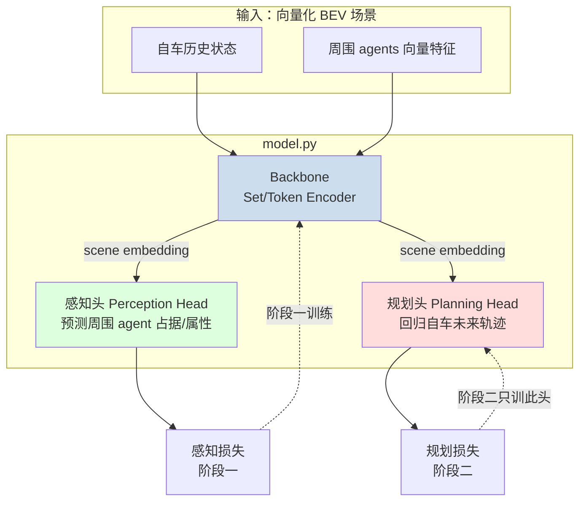
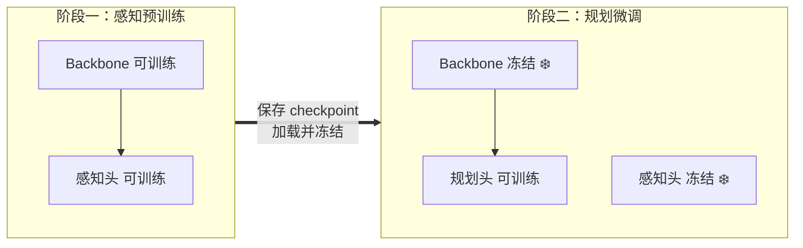
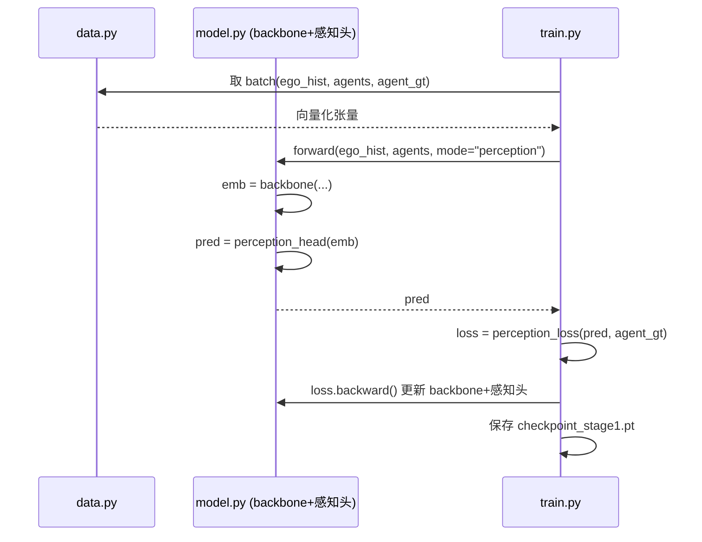
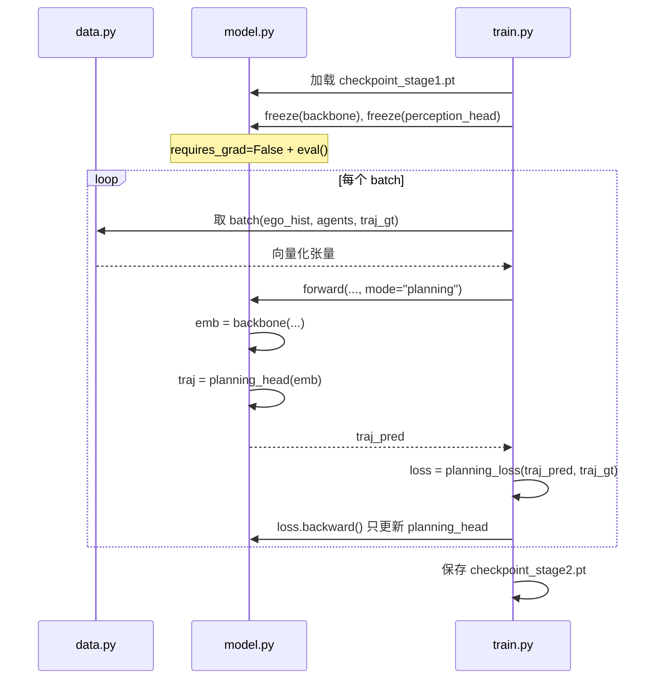

# 设计文档：nano-fsd

## 概述

nano-fsd 是一个 nanoGPT 量级的端到端自动驾驶模仿学习项目，目标是"麻雀虽小五脏俱全"地学习端到端自动驾驶的核心概念：**向量化场景表示 → 共享 backbone → 解耦的感知头/规划头 → 分阶段冻结训练 → 轨迹预测与可视化**。

整个项目保持 nanoGPT 式的极简风格：几个 Python 文件、几百行代码、单张 RTX 3090 上快速迭代出"看得见"的效果。模型采用一段式（end-to-end）设计，但三个模块（backbone、感知头、规划头）在代码层面解耦，使得你可以亲手体验"冻结 backbone + 感知头的参数、只训练规划头"这一核心工程操作。

本文档是一份**分步施工图**，不是成品代码。每个章节给出接口契约、张量形状、算法伪代码（Python 风格签名 + 注释），你照着自己手写实现。文件结构：`model.py`（backbone + 两个头）、`data.py`（数据加载）、`train.py`（支持分阶段冻结）、`viz.py`（BEV 轨迹可视化）。

**成功标准**：在 BEV 图上画出规划头预测的自车未来轨迹 vs 真实轨迹，两者在视觉上基本吻合（直行、转弯等典型场景轨迹合理）。

---

## 关键设计决策

### 为什么用向量化场景而不是原始图像

端到端自动驾驶的学术主线（如 UniAD）确实从多相机图像出发，但那会把大量精力耗在图像特征提取、多相机 BEV 投影（LSS / BEVFormer 等）的工程复杂度上。对一个"学习端到端概念"的小项目，这是不必要的负担。我们直接采用**向量化 / BEV 场景表示**作为输入：场景中每个 agent 用一组特征向量（位置、速度、朝向、类别、历史轨迹点）描述，自车同样如此。这样 backbone 可以是一个轻量的集合编码器（set encoder），把注意力集中在"感知头 / 规划头 / 分阶段训练"这些真正想学的概念上。

### 数据集推荐：nuScenes v1.0-mini

| 候选 | 体积 | 适配度 | 结论 |
|------|------|--------|------|
| **nuScenes v1.0-mini** | ~4 GB | 10 个场景，自带 agent 标注、自车位姿、地图；`nuscenes-devkit` 工具链成熟，取轨迹方便 | **推荐** |
| Argoverse 2 Motion Forecasting | ~100+ GB（完整） | 纯向量化、专为预测设计，但完整集太大，下载和存储成本高 | 备选（若想纯做运动预测） |
| Waymo Open Motion | 很大 | 质量高但入门门槛和体积都偏大 | 不推荐入门 |

**选 nuScenes mini 的理由**：
1. 体积小（约 4 GB），单机下载快，3090 上可全量载入内存或轻量缓存。
2. 同时含 **agent 标注**（喂给感知头）和 **自车真值轨迹**（喂给规划头），一个数据集覆盖两个阶段，非常契合"backbone + 感知头 + 规划头"的三段式结构。
3. `nuscenes-devkit` 提供现成 API，省去自己解析原始格式的工程量，符合 nanoGPT"降低门槛"的精神。

> 实现时你只用到 mini 集里的「向量化信息」：各 agent 的框中心/朝向/速度/类别、自车历史与未来位姿。不碰相机图像和点云，保持输入是纯向量。

### 坐标系约定

所有坐标统一到**以自车当前时刻为原点的自车坐标系（ego-centric）**：x 向前、y 向左，单位米。网络的输入和输出都在这个坐标系下，避免处理全局坐标带来的数值和归一化问题。

---

## 系统架构



分阶段训练示意：



---

## 主流程时序图

### 阶段一：感知预训练



### 阶段二：规划微调（冻结）



---

## 数据模型

所有张量约定 batch 维在前。记号：`B`=batch，`N`=场景中 agent 上限（padding 到定长），`Th`=历史步数，`Tf`=未来步数，`C`=每 agent 特征维，`D`=embedding 维。

### 配置对象

```python
# config.py 风格的简单 dataclass，nanoGPT 式集中管理超参
@dataclass
class Config:
    # 场景维度
    n_agents: int = 32        # N: padding 后的 agent 数上限
    hist_steps: int = 4       # Th: 历史帧数
    fut_steps: int = 12       # Tf: 预测未来帧数 (nuScenes 2Hz -> 6s)
    agent_feat_dim: int = 8   # C: [x, y, vx, vy, cos_yaw, sin_yaw, cls_onehot...]
    # 模型维度
    d_model: int = 128        # D
    n_heads: int = 4
    n_layers: int = 3
    # 训练
    lr: float = 3e-4
    batch_size: int = 64
    device: str = "cuda"
```

### 输入样本结构

```python
@dataclass
class Sample:
    ego_hist:  Tensor   # (Th, 4)   自车历史: [x, y, vx, vy]，ego 坐标系
    agents:    Tensor   # (N, Th, C) 周围 agent 历史特征, padding
    agent_mask: Tensor  # (N,)       True=有效 agent, False=padding
    # 监督信号
    agent_gt:  Tensor   # (N, 2) 或占据栅格  周围 agent 真值（感知头用）
    traj_gt:   Tensor   # (Tf, 2)   自车未来轨迹真值（规划头用），ego 坐标系
    traj_mask: Tensor   # (Tf,)     未来轨迹有效位（场景末尾可能不足 Tf）
```

**验证规则**：
- `ego_hist` 最后一帧（当前时刻）位置应约等于原点 `(0,0)`，因为是 ego-centric。
- `agents` 中 `agent_mask=False` 的行必须全零，损失计算时按 mask 忽略。
- `traj_gt` 的点按时间顺序排列，相邻点欧氏距离应落在合理范围（速度不超物理上限），可作为数据清洗断言。
- 坐标在喂入网络前做标准化（除以场景尺度，如 50m），输出时再反标准化。

### 感知头输出的两种选择（二选一，建议从简单的开始）

| 方案 | 输出形状 | 损失 | 难度 |
|------|---------|------|------|
| **A. agent 位置回归**（推荐入门） | `(N, 2)` 预测各 agent 相对位置 | masked MSE | 低，直观 |
| B. BEV 占据栅格 | `(H, W)` 占据概率图 | BCE / Focal | 中，更"感知"但要栅格化 |

设计默认走方案 A，字段 `agent_gt: (N,2)`。如果想加深理解再升级到方案 B。

---

## 组件与接口

### 组件 1：Backbone（场景编码器）

**职责**：把自车历史 + 周围 agents 的向量特征编码成统一的场景 embedding，供两个头共享。

**选型**：轻量 Transformer encoder（把每个 agent 当作一个 token，自车作为特殊 token），或更简单的 per-agent MLP + 注意力池化。nanoGPT 量级建议直接复用 `nn.TransformerEncoderLayer`。

```python
class Backbone(nn.Module):
    def __init__(self, cfg: Config): ...

    def forward(self, ego_hist: Tensor, agents: Tensor,
                agent_mask: Tensor) -> Tensor:
        """
        输入:
          ego_hist   (B, Th, 4)
          agents     (B, N, Th, C)
          agent_mask (B, N)
        输出:
          scene_emb  (B, N+1, D)   # token 0 = ego token, 1..N = agent tokens
        约束:
          - padding 的 agent 在注意力中被 key_padding_mask 屏蔽
          - 输出 token 顺序与输入 agent 顺序一一对应（供感知头按位监督）
        """
```

### 组件 2：感知头（Perception Head）

**职责**：从场景 embedding 预测周围 agent 的属性（方案 A：相对位置）。阶段一与 backbone 一起训练。

```python
class PerceptionHead(nn.Module):
    def forward(self, scene_emb: Tensor) -> Tensor:
        """
        输入 scene_emb (B, N+1, D)
        输出 agent_pred (B, N, 2)   # 取 token 1..N 过 MLP -> (x,y)
        """
```

### 组件 3：规划头（Planning Head）

**职责**：从场景 embedding（主要用 ego token）回归自车未来轨迹。阶段二单独训练。

```python
class PlanningHead(nn.Module):
    def forward(self, scene_emb: Tensor) -> Tensor:
        """
        输入 scene_emb (B, N+1, D)
        输出 traj_pred (B, Tf, 2)
        实现建议:
          ego_token = scene_emb[:, 0]        # (B, D)
          # 可选: 对所有 token 做一次 cross-attention 让规划"看见"周围 agent
          traj = mlp(ego_token).view(B, Tf, 2)   # 最简版: 直接回归 Tf*2
        """
```

### 组件 4：NanoFSD（顶层模型，整合三件套 + 冻结开关）

```python
class NanoFSD(nn.Module):
    def __init__(self, cfg: Config):
        self.backbone = Backbone(cfg)
        self.perception_head = PerceptionHead(cfg)
        self.planning_head = PlanningHead(cfg)

    def forward(self, ego_hist, agents, agent_mask, mode: str) -> Tensor:
        """mode ∈ {"perception", "planning"}；返回对应头的输出"""

    def freeze_perception_stack(self) -> None:
        """阶段二调用：冻结 backbone + perception_head"""
```

---

## 关键函数的形式化规格

### 函数 1：Backbone.forward

```python
def forward(self, ego_hist, agents, agent_mask) -> scene_emb
```

**前置条件（Preconditions）：**
- `ego_hist.shape == (B, Th, 4)`，无 NaN。
- `agents.shape == (B, N, Th, C)`，`agent_mask.shape == (B, N)` 且 dtype 为 bool。
- 坐标已标准化到 `[-1, 1]` 量级附近。

**后置条件（Postconditions）：**
- 返回 `scene_emb.shape == (B, N+1, D)`。
- token 0 对应自车，token `i`（1..N）对应输入第 `i-1` 个 agent（顺序保持）。
- padding 位置的输出不影响有效位置的计算结果（通过 key_padding_mask 保证）。

**循环不变式：** 若用多层 encoder，每层处理后 token 数维度恒为 `N+1`，顺序不变。

### 函数 2：planning_loss

```python
def planning_loss(traj_pred, traj_gt, traj_mask) -> Tensor
```

**前置条件：**
- `traj_pred.shape == traj_gt.shape == (B, Tf, 2)`。
- `traj_mask.shape == (B, Tf)`，bool。

**后置条件：**
- 返回标量 loss ≥ 0。
- 当 `traj_pred == traj_gt`（在有效位）时 loss == 0。
- 仅在 `traj_mask == True` 的时间步上计算（padding 未来步被忽略）。

**循环不变式：** N/A（向量化实现，无显式循环）。

### 函数 3：freeze_perception_stack

```python
def freeze_perception_stack(self) -> None
```

**前置条件：** 已从 `checkpoint_stage1.pt` 加载好 backbone + 感知头权重。

**后置条件：**
- `backbone` 和 `perception_head` 下所有参数 `requires_grad == False`。
- `planning_head` 下所有参数 `requires_grad == True`。
- backbone / perception_head 置为 `eval()` 模式（关闭 dropout / 固定 BN 统计），避免冻结后仍受训练态影响。

---

## 算法伪代码

### 算法 A：阶段一感知预训练主循环

```python
def train_stage1(cfg):
    """
    前置: data.py 能产出含 agent_gt 的 batch
    后置: 保存 checkpoint_stage1.pt (含 backbone + perception_head 权重)
    """
    model = NanoFSD(cfg).to(cfg.device)
    opt = AdamW(model.parameters(), lr=cfg.lr)   # 全部参数都训
    for step, batch in enumerate(loader):
        pred = model(batch.ego_hist, batch.agents,
                     batch.agent_mask, mode="perception")   # (B, N, 2)
        # 不变式: 只在有效 agent 上算损失
        loss = masked_mse(pred, batch.agent_gt, batch.agent_mask)
        opt.zero_grad(); loss.backward(); opt.step()
    save({"model": model.state_dict()}, "checkpoint_stage1.pt")
```

### 算法 B：阶段二规划微调主循环（核心学习点：冻结）

```python
def train_stage2(cfg):
    """
    前置: 存在 checkpoint_stage1.pt
    后置: 保存 checkpoint_stage2.pt；backbone/感知头权重不变，仅 planning_head 更新
    """
    model = NanoFSD(cfg).to(cfg.device)
    ckpt = load("checkpoint_stage1.pt")
    model.load_state_dict(ckpt["model"], strict=False)  # 规划头可能是新初始化

    model.freeze_perception_stack()        # ❄️ 冻结 backbone + 感知头
    # 关键: optimizer 只收集 requires_grad=True 的参数（即规划头）
    trainable = [p for p in model.parameters() if p.requires_grad]
    assert all(p is in planning_head for p in trainable)  # 自检
    opt = AdamW(trainable, lr=cfg.lr)

    for step, batch in enumerate(loader):
        # backbone 前向可包在 no_grad 里省显存（因为不回传）
        traj_pred = model(batch.ego_hist, batch.agents,
                          batch.agent_mask, mode="planning")  # (B, Tf, 2)
        loss = planning_loss(traj_pred, batch.traj_gt, batch.traj_mask)
        opt.zero_grad(); loss.backward(); opt.step()
    save({"model": model.state_dict()}, "checkpoint_stage2.pt")
```

### 算法 C：masked MSE（感知头与规划头共用的核心损失）

```python
def masked_mse(pred, gt, mask):
    """
    pred,gt: (..., K); mask: (...) bool
    不变式: 分母为有效元素数, 避免被 padding 稀释
    """
    err = ((pred - gt) ** 2).sum(dim=-1)   # 每个元素的平方误差
    err = err * mask.float()
    return err.sum() / mask.float().sum().clamp(min=1)
```

### 算法 D：BEV 轨迹可视化

```python
def visualize(sample, traj_pred):
    """
    在同一张 BEV 图上画: 周围 agent 框 + 真值轨迹(绿) + 预测轨迹(红)
    成功判据: 直行场景两条线接近; 转弯场景预测能跟上弯道趋势
    """
    fig, ax = plt.subplots()
    draw_agents(ax, sample.agents, sample.agent_mask)   # 画周围车辆
    ax.plot(sample.traj_gt[:,0],  sample.traj_gt[:,1],  'g-o', label="GT")
    ax.plot(traj_pred[:,0],       traj_pred[:,1],       'r-x', label="Pred")
    ax.plot(0, 0, 'b^', markersize=12, label="Ego")     # 自车在原点
    ax.set_aspect('equal'); ax.legend()
```

---

## 示例用法

```python
# 一次完整的"分阶段"流程，对应你会在终端里敲的命令
# 阶段一: python train.py --stage 1
train_stage1(cfg)        # -> checkpoint_stage1.pt

# 阶段二: python train.py --stage 2  (冻结感知栈)
train_stage2(cfg)        # -> checkpoint_stage2.pt

# 可视化: python viz.py --ckpt checkpoint_stage2.pt
model = NanoFSD(cfg); model.load_state_dict(load("checkpoint_stage2.pt")["model"])
model.eval()
sample = dataset[0]
with torch.no_grad():
    traj = model(sample.ego_hist[None], sample.agents[None],
                 sample.agent_mask[None], mode="planning")[0]
visualize(sample, denormalize(traj))
```

---

## 正确性属性（Correctness Properties）

这些是实现后应当成立的性质，可写成断言或单元测试：

1. **形状守恒**：∀ 合法输入，`backbone` 输出恒为 `(B, N+1, D)`；`planning_head` 输出恒为 `(B, Tf, 2)`。
2. **padding 不变性**：∀ 两个仅在 padding agent 内容上不同的输入，有效 agent 的感知/规划输出应完全一致（key_padding_mask 生效的证据）。
3. **冻结正确性**：阶段二一个训练步前后，`backbone` 与 `perception_head` 的所有参数张量逐元素相等；`planning_head` 至少一个参数发生变化。
4. **损失零点**：∀ `pred == gt`（有效位），`masked_mse`/`planning_loss` 返回 0。
5. **mask 单调性**：增加 padding（更多无效位）不改变有效位上的 loss 值。
6. **ego 原点性**：∀ 样本，`ego_hist[-1]` 的位置分量范数 < ε（接近原点）。
7. **过拟合可行性**（学习型 sanity check）：在单个 batch 上反复训练，规划 loss 应能被压到接近 0——证明模型容量和梯度链路通畅。

---

## 错误处理

### 场景 1：checkpoint 缺失或键不匹配
**条件**：阶段二找不到 `checkpoint_stage1.pt`，或 `load_state_dict` 键不对齐（规划头是新加的）。
**响应**：阶段二用 `strict=False` 加载，并打印缺失/多余键供人工确认；若 stage1 文件不存在则直接报错提示先跑阶段一。
**恢复**：先运行 `train.py --stage 1`。

### 场景 2：空场景 / 全 padding batch
**条件**：某样本周围没有有效 agent，`agent_mask` 全 False。
**响应**：`masked_mse` 的分母用 `clamp(min=1)` 防除零；该样本感知 loss 贡献为 0。
**恢复**：数据层过滤掉有效 agent 数为 0 的样本更干净。

### 场景 3：未来轨迹长度不足 Tf
**条件**：场景临近结尾，真值未来点不足 `Tf`。
**响应**：pad 到 `Tf` 并用 `traj_mask` 标记无效步，损失忽略。
**恢复**：无需额外处理。

### 场景 4：显存不足（3090 24GB）
**条件**：`n_agents` 或 `batch_size` 过大。
**响应**：阶段二 backbone 前向用 `torch.no_grad()`；必要时减小 batch 或开 AMP（`torch.cuda.amp`）。
**恢复**：这些都是单文件内可调的超参，符合 nanoGPT 式快速试错。

---

## 测试策略

### 单元测试
- `backbone` / 两个头的输出形状测试（对应正确性属性 1）。
- `masked_mse` 的零点与 mask 单调性测试（属性 4、5）。
- `freeze_perception_stack` 后参数 `requires_grad` 状态测试（属性 3 的静态部分）。

### 基于属性的测试（Property-Based Testing）
- **库**：`hypothesis`。
- 对随机形状的 `(B, N, Tf)` 和随机 mask，验证 padding 不变性（属性 2）与 mask 单调性（属性 5）。
- 验证损失零点性质：随机生成 `gt`，令 `pred=gt`，断言 loss≈0。

### 集成测试（学习型 sanity check）
- **单 batch 过拟合**：取一个固定 batch，跑若干步，断言规划 loss 显著下降（属性 7）。这是判断"管道是否打通"最快的信号。
- **冻结端到端验证**：跑一个阶段二训练步，前后对比 backbone 参数哈希，断言不变（属性 3）。

---

## 性能考量

- 目标是单张 3090 上**几分钟到几十分钟**跑出可视化效果，不追求 SOTA 精度。
- nuScenes mini 很小，建议一次性预处理成向量张量缓存到磁盘（`.pt`），避免每个 epoch 重复调用 devkit。
- backbone 用 3 层、`d_model=128` 足够；先把管道跑通，再按需加大。
- 阶段二 backbone 前向 `no_grad` 可明显降低显存与时间。

---

## 依赖

| 依赖 | 用途 |
|------|------|
| `torch` | 模型与训练 |
| `nuscenes-devkit` | 读取 nuScenes mini 的 agent 标注与自车位姿 |
| `numpy` | 向量化预处理 |
| `matplotlib` | BEV 轨迹可视化（viz.py） |
| `hypothesis`（可选） | 基于属性的测试 |
| `tqdm`（可选） | 训练进度条 |

---

## 分步施工路线（照此顺序手写实现）

> 这是本设计作为"施工图"的落脚点，建议按序推进，每一步都能独立验证。

1. **data.py — 预处理与缓存**：用 devkit 把 nuScenes mini 转成 `Sample` 张量，转到 ego 坐标系、标准化、padding，缓存成 `.pt`。先只做"返回正确形状的假数据/真数据"，用正确性属性 1、6 自测。
2. **model.py — Backbone + 两个头**：按接口和形状契约搭 `NanoFSD`，先用随机输入跑通前向，验证形状守恒与 padding 不变性。
3. **train.py 阶段一**：接上 `masked_mse`，先做单 batch 过拟合 sanity check（属性 7），再全量训练，存 `checkpoint_stage1.pt`。
4. **train.py 阶段二 + 冻结**：实现 `freeze_perception_stack`，加载 stage1 权重，验证冻结正确性（属性 3），训练规划头存 `checkpoint_stage2.pt`。
5. **viz.py — BEV 可视化**：画 GT vs Pred 轨迹，达成成功标准（直行/转弯轨迹视觉吻合）。
6. **（可选进阶）** 感知头从位置回归升级为 BEV 占据栅格；规划头加入对周围 agent 的 cross-attention。
