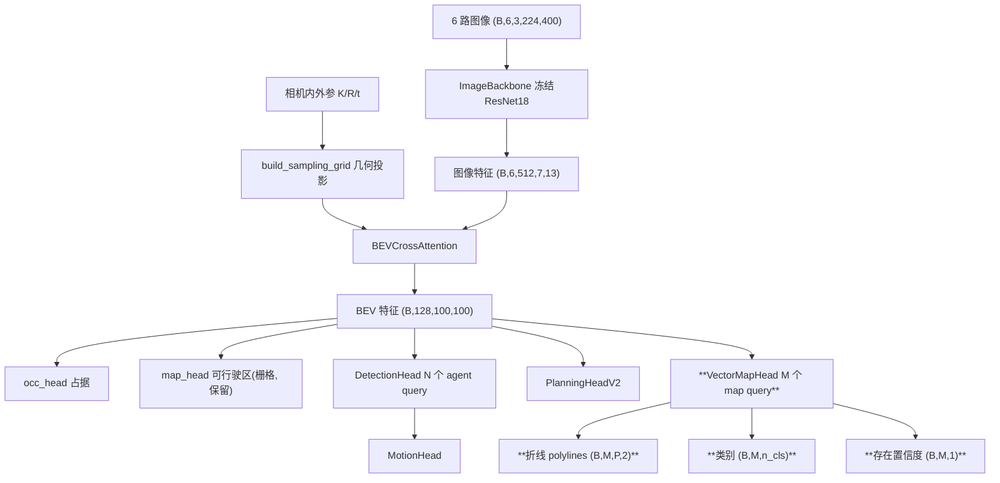
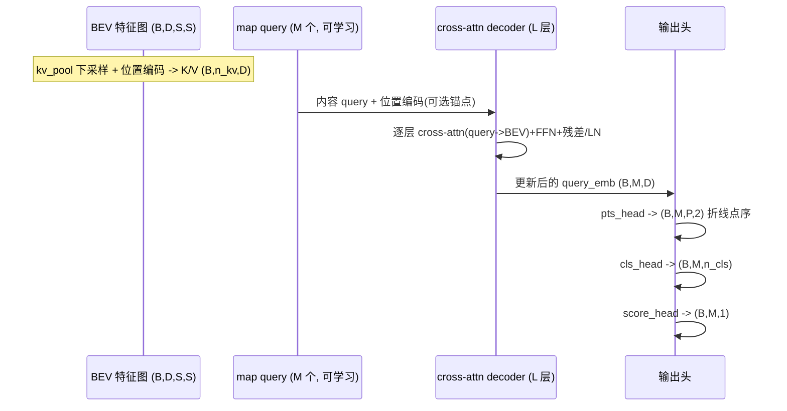

# 设计文档：vector-map-head — 对齐 UniAD MapFormer 的「真·矢量化」地图头

## 概述

现有 nano-fsd-v2 的 `map_head` 只做**栅格可行驶区分割**（稠密 BCE，输出 (B,1,S,S) 概率
图），这对应 UniAD 里最浅层的地图理解。本设计补上 UniAD **MapFormer 的核心能力——矢量化
地图**：不再输出一张「哪里是路面」的像素图，而是像检测头输出一个个 agent 框那样，输出
**一条条折线（polyline）**，每条折线是一串有序点（固定 P 个点），并带类别（车道分隔线 /
道路边界 / 人行横道）与存在置信度。

本设计是用户讨论的三档方案中的 **tier 2**：
- tier 1（已有）：栅格可行驶区分割（`map_head`，保留不动）。
- **tier 2（本设计）：query-based 矢量折线头**，M 个地图 query attend BEV 特征，每个
  query 回归一条折线 + 类别 + 置信度。输出是**点序列（向量）**，不是栅格掩码。
- tier 3（非目标）：带车道拓扑/方向/连通关系的完整矢量地图（HDMapNet/VectorMapNet/
  MapTR 的全量能力）。本设计明确不做拓扑与方向。

贯穿本设计的主线与 nano-fsd-v2 完全一致——**query 作为信息载体 + 预测/GT 匹配 + 带 mask
的回归 loss**。地图头在结构上几乎是检测头（DetectionHead）的「孪生兄弟」：把「每个 query
出一个 5 维框」换成「每个 query 出一条 P×2 的折线」，把「框中心贪心匹配」换成「折线贪心
匹配」，把「框 smooth L1」换成「点序列 L2」。这种刻意的对称让它易学、易验证、易复用现有
匹配与可视化基建。

### 设计目标与非目标

**目标**
- 新增一个**真矢量**地图头 `VectorMapHead`：M 个 query → 每条折线 (P,2) + 类别 (n_cls) +
  存在置信度 (1)。输出点序列，不是栅格。
- 数据层从 nuScenes 地图扩展（`data/nuScenes-map-expansion-v1.3/`）抽取**矢量**车道分隔
  线 / 道路边界 / 人行横道，转到 ego 系、`SCENE_SCALE=50` 归一化、重采样到定长 P 点、pad
  到定长 `MAX_MAP` 条折线 + mask。**需要重建缓存**（新字段，向后兼容旧缓存）。
- 折线匹配（贪心，类比检测头）+ 折线回归 loss（点序 L2，含「正序/反序」取小的顺序鲁棒）
  + 类别 CE + 存在性 BCE。
- 可视化：在 `visualize.py` 的俯视图上叠加**预测 vs GT 折线**（复用 ego 系 x前/y左 约定、
  Agg 后端、英文图标题、中文 docstring）。
- 全程单卡 24G 可训；backbone 维持冻结（可选解冻）；沿用「一次一个改动、小子集先验证再
  全量重建」的节奏。

**非目标（相对 UniAD MapFormer 的简化，必须显式记录）**
- **固定点数 P/条**（如 P=20）：不处理可变长度折线，不做点数自适应。
- **贪心匹配**而非匈牙利（Hungarian）：与检测头一致，便于讲解「哪条 query 负责哪条 GT」。
- **无车道拓扑 / 无方向 / 无连通性**：折线是无向点序列，不建 lane graph，不预测前驱后继。
- 不替换、不删除已有栅格 `map_head`（两者并存，栅格给稠密监督，矢量给结构化输出）。
- 不改动已验证的 image_backbone 与 bev_encoder 几何。

### 与 UniAD MapFormer 的对应关系（学习锚点）

| UniAD MapFormer | 本设计对应 | 简化点 |
|-----------------|-----------|--------|
| 地图 query attend BEV | `VectorMapHead` 的 M 个 map query cross-attn BEV | 标准注意力，kv_stride 下采样 |
| 矢量地图元素（折线/多边形） | 每 query 一条定长折线 (P,2) | 固定 P 点，仅折线（人行横道也折线化为边界环） |
| 元素类别（分隔线/边界/人行横道等） | `cls` (M,n_cls)，3 类 | 3 类，无细分子类 |
| 二分匹配（Hungarian）+ 点集 loss | 贪心匹配 + 点序 L2（正/反序取小） | 贪心代替匈牙利 |
| 车道方向 / 拓扑 / 连通 | 不做 | 无向、无拓扑（tier 3 才做） |
| 实例级可微栅格化监督 | 不做 | 仅点回归 + 存在性 |

## 架构

### 整体数据流（新增部分加粗，其余为 nano-fsd-v2 现状）



地图头与检测头是**平行的两个 query-based 头**，都挂在同一张 BEV 特征图之后，互不依赖。
agent query 管「动态目标」，map query 管「静态矢量地图元素」。这与 UniAD 里 TrackFormer 与
MapFormer 平行的结构一致。

### query→折线 的内部流程（与 DetectionHead 对称）



### 关键设计决策

**决策 1：query-based 折线回归（镜像检测头），而非栅格后处理矢量化**
- 选择：M 个可学习 map query，经 L 层 cross-attn decoder attend BEV，每 query 直接回归
  一条折线 (P,2) + 类别 + 存在置信度。
- 理由：与 UniAD MapFormer 一致，也与本项目 DetectionHead 结构同构——最大化复用匹配/
  loss/可视化模式，学习成本低。栅格再矢量化（如 skeletonize）不可微、流程脆弱，弃用。
- 代价：需要「预测折线-GT 折线」匹配（决策 3）。

**决策 2：固定 P 点/折线 + 重采样（弧长等距），不处理变长**
- 选择：每条折线固定 P 个点（默认 P=20）。GT 折线按**弧长等距重采样**到 P 点；预测折线
  也是 P 点。人行横道是多边形环，取其外轮廓按弧长重采样为 P 点闭合折线。
- 理由：定长张量最省事、最好 batch、最易写属性测试（形状守恒）。UniAD/MapTR 同样用固定
  点数。弧长等距保证点分布均匀、loss 稳定。
- 简化点（明确记录）：丢失原始点数信息；极长折线会被稀疏化、极短折线会被过采样。

**决策 3：折线贪心匹配（类比检测头的 match_pred_to_gt）**
- 选择：新增 `match_polyline_to_gt`：预测折线与 GT 折线的「折线间距离」（见下）构成距离
  矩阵，按 GT 到自车距离近者优先，贪心指派最近且未占用的预测 query。可选类内匹配
  （同类才可配）。
- 理由：与检测头完全同构，便于复用与讲解。匈牙利匹配留作 tier 3 增强。
- 折线间距离定义：两条折线逐点 L2 的均值，并对 GT 取「正序」与「点序翻转」两种对齐的
  较小者（道路边界/车道线无固有方向，顺序不该惩罚）——这是本头特有的「顺序鲁棒」点。

**决策 4：折线回归 loss = 顺序鲁棒点序 L2（正/反序取小）**
- 选择：匹配后，对每对 (pred, gt) 折线算「正序逐点 L2」与「反序逐点 L2」，取较小者作为
  该折线的回归误差；对匹配折线求和后按匹配总数平均。
- 理由：地图线元素无方向，强制点序会制造虚假大误差。取正/反序较小者让 loss 对折线整体
  朝向不敏感，但仍惩罚形状偏差。保持零点性质（pred==gt 时为 0）。
- 简化点：只做「整体正序/反序」两种对齐，不做任意点置换（Chamfer）。Chamfer 列为可选
  增强（见测试策略里对应属性为「可选」）。

**决策 5：数据层新增矢量 GT，复用现有 global→ego 变换与城市地图缓存**
- 选择：在 `build_meta_cache.py` 新增 `build_map_polylines`，复用 `_ego_g2e`（当前帧
  global→ego）与 `_get_map(city)`（按城市缓存 `NuScenesMap`），抽取 ego 周围 ±BEV_RANGE
  内的 `lane_divider`、`road_divider`、`road_segment`/`drivable_area` 边界、`ped_crossing`，
  转到 ego 系、裁剪、弧长重采样为 P 点，pad 到 `MAX_MAP` 条 + mask。
- 理由：几何变换与地图加载都已在 `build_drivable_bev` 验证过，直接复用降低风险。坐标与
  归一化沿用 `SCENE_SCALE`，与 traj/agent 字段一致。
- 规模：`MAX_MAP` 可变，pad 到固定上限（默认 48）+ mask，与模型 M 对齐。**需重建缓存**。

**决策 6：三类地图元素，类别就近归并**
- 选择：3 类——0=车道分隔线（`lane_divider` + `road_divider`）、1=道路边界（`road_segment`/
  `drivable_area` 的外轮廓边界）、2=人行横道（`ped_crossing`）。
- 理由：覆盖 UniAD MapFormer 常用的三大矢量元素，类别少、好学、好画。
- 简化点：车道分隔线不区分实虚线/颜色；道路边界不区分路缘类型。

**决策 7：与栅格 map_head 并存，分步/权重可控**
- 选择：保留 `map_head`（栅格可行驶区）不动；新增 `VectorMapHead` 作为独立头。总损失新增
  `w_vmap·L_vmap`，`w_vmap=0` 可干净关闭（分步验证用，沿用现有「权重为 0 短路」机制）。
- 理由：遵循「一次加一个头」。栅格头给稠密像素监督帮助 BEV 学结构，矢量头给结构化输出，
  两者互补，不冲突。

## 组件与接口

### 组件 1：数据侧矢量地图 GT（build_meta_cache.py 扩展）

**职责**：遍历样本时，除现有 occ/drivable/traj/command/agent_* 外，额外抽取当前帧 ego
周围的矢量地图元素，缓存为定长张量。

**新增缓存字段（每条 record；numpy，未归一化，由 Dataset 侧统一除 SCENE_SCALE）**

| 字段 | 形状 | 含义 |
|------|------|------|
| map_pts | (MAX_MAP, P, 2) | 每条折线 P 个点 `[x,y]`（ego 系，米；x 前 y 左） |
| map_cls | (MAX_MAP,) | 类别 id ∈ {0=分隔线,1=边界,2=人行横道} |
| map_mask | (MAX_MAP,) | bool，有效折线位 |

**接口（低层签名 + 伪代码）**
```python
# build_meta_cache.py
MAX_MAP = 48          # 每帧矢量折线定长上限，与模型 M query 对齐
MAP_POINTS = 20       # 每条折线固定点数 P（弧长等距重采样）
# 地图图层 -> 3 类归并
_MAP_LAYERS = {
    "lane_divider": 0, "road_divider": 0,     # 0=车道分隔线
    "road_segment": 1, "drivable_area": 1,    # 1=道路边界（取外轮廓）
    "ped_crossing": 2,                        # 2=人行横道
}

def resample_polyline(pts: np.ndarray, n: int) -> np.ndarray:
    """把任意点数的折线按**弧长等距**重采样成固定 n 个点，返回 (n,2)。

    前置：pts (K,2) K>=2 的 ego 系折线点序。
    后置：返回 (n,2)；端点保持（首点=原首点、末点=原末点）；点沿弧长均匀分布。
    """
    # 伪代码：
    #   seg = 相邻点欧氏距离；cum = [0, 累积弧长]；total = cum[-1]
    #   if total == 0: return 原首点重复 n 次            # 退化：所有点重合
    #   targets = linspace(0, total, n)
    #   for each target t: 在 cum 上二分找所在段，线性插值得点
    #   return 插值得到的 (n,2)

def build_map_polylines(nusc, sample, city: str) -> dict:
    """抽取当前帧 ego 周围 ±BEV_RANGE 的矢量地图元素，转 ego 系、裁剪、重采样、pad。

    - 取 ego 全局 (x,y,yaw)；用 _get_map(city) 的 NuScenesMap 查询半径内各图层记录。
    - 车道/道路分隔线：取其中心线/线几何的点序列；道路边界：取 drivable_area/road_segment
      多边形的外轮廓；人行横道：取 ped_crossing 多边形外轮廓（闭合）。
    - 用 _ego_g2e(nusc, sample) 把每个点从 global 转到当前帧 ego 系（x 前 y 左）。
    - 裁剪到 |x|<=BEV_RANGE 且 |y|<=BEV_RANGE 内的点段；一条几何被裁成多段时各自成折线。
    - resample_polyline 到 MAP_POINTS 点；按到自车距离近者优先，超 MAX_MAP 截断。
    - 返回定长 pad 字典：map_pts (MAX_MAP,P,2)、map_cls (MAX_MAP,)、map_mask (MAX_MAP,)。
      无任何元素时 map_mask 全 False（空场景安全）。
    """
```

**正确性属性引用**：属性 1（形状守恒）、属性 2（ego 对齐）、属性 7（重采样等距性）、
属性 8（空场景安全）。

### 组件 2：Dataset 读取矢量字段（dataset.py 扩展）

**职责**：`__getitem__` 读出 3 个新字段转张量；`map_pts` 的 xy 用 `SCENE_SCALE` 归一化
（与 traj/agent 一致）；旧缓存缺字段时填零 + mask 全 False（向后兼容）。

**接口（在现有 agent 字段读取之后追加同样的 try/缺省模式）**
```python
# dataset.py 常量
MAP_MAX = 48
MAP_POINTS = 20

# __getitem__ 内（紧随 agent_* 的读取之后）：
if "map_pts" in rec:
    map_pts = torch.from_numpy(rec["map_pts"]).float()      # (MAX_MAP,P,2) 米
    map_pts = map_pts / SCENE_SCALE                          # xy 归一化（与 traj 一致）
    out["map_pts"] = map_pts
    out["map_cls"] = torch.from_numpy(rec["map_cls"]).long()   # (MAX_MAP,)
    out["map_poly_mask"] = torch.from_numpy(rec["map_mask"]).bool()  # (MAX_MAP,)
else:
    out["map_pts"] = torch.zeros(MAP_MAX, MAP_POINTS, 2)
    out["map_cls"] = torch.zeros(MAP_MAX, dtype=torch.long)
    out["map_poly_mask"] = torch.zeros(MAP_MAX, dtype=torch.bool)
```
> 命名注意：GT mask 键用 `map_poly_mask`，避免与可能存在的其它 `map_mask` 概念混淆；
> 栅格 `drivable` 字段保持不变。`collate` 已通用无需改动。

**正确性属性引用**：属性 1、属性 8。

### 组件 3：VectorMapHead（矢量地图头，model.py 新增）

**职责**：M 个 map query 经 L 层 cross-attn attend BEV 特征，输出每 query 的折线点序、
类别 logit、存在置信度，并暴露 query embedding（便于将来规划头消费地图信息）。

**结构（镜像 DetectionHead）**
- `nn.Parameter` map_query_content (M, D)（可学习内容）。
- 可选锚点位置编码：在 BEV 平面均匀铺 M 个锚点坐标，经 MLP 编码后加到内容 query（与
  DetectionHead 的 anchor_pos_mlp 同款，稳定匹配）。折线锚点用「锚点中心 + 学习偏移」
  初始化每条折线的 P 个点基准。
- `kv_pool`（AvgPool2d，kv_stride 下采样）+ `bev_pos`（K/V 位置编码），与检测头同款。
- L 层 decoder：每层 = cross-attn(query→BEV) + FFN + 残差/LN。
- 输出头（各一个 MLP）：
  - `pts_head`：D → P*2，reshape (B,M,P,2)。折线点 = 锚点基准 + tanh 限幅偏移（可选，防
    发散；或直接回归归一化坐标）。
  - `cls_head`：D → n_cls（默认 3）。
  - `score_head`：D → 1（存在置信度 logit）。
- `query_emb` (B,M,D)：最后一层输出。

**接口**
```python
class VectorMapHead(nn.Module):
    def __init__(self, d_model: int = 128, n_query: int = 48, n_points: int = 20,
                 n_layers: int = 2, n_cls: int = 3, bev_size: int = 100,
                 kv_stride: int = 2, n_heads: int = 4,
                 bev_range: float = 50.0, scene_scale: float = 50.0): ...

    def forward(self, bev: Tensor) -> dict:
        """bev (B,D,S,S) -> {
            'pts':   (B,M,P,2)   折线点序（SCENE_SCALE 归一化的 ego 系 xy）
            'cls':   (B,M,n_cls) 类别 logit
            'score': (B,M,1)     存在置信度 logit
            'query_emb': (B,M,D) map query embedding
            ['anchor_xy': (M,2)] 可选固定锚点中心，供匹配用
        }"""
```
**前置条件**：bev (B,D,S,S)，D=d_model。
**后置条件**：所有输出 batch 维在前，M 维一致；pts 可微，与 cls/score 来自同一 query。
**循环不变式（decoder 层）**：每层后 query 形状恒为 (B,M,D)，顺序一一对应。

### 组件 4：NanoFSDv2 顶层整合（model.py 扩展）

**职责**：在现有 forward 的 dict 输出中新增 `vmap` 键（矢量地图头输出 dict）。地图头
**始终计算**（与 det 一致，保证 dict 完整），M 很小开销可忽略。

**接口（在现有 __init__ / forward 增量）**
```python
class NanoFSDv2(nn.Module):
    def __init__(self, ..., n_map_query: int = 48, n_map_points: int = 20,
                 n_map_cls: int = 3, use_vector_map: bool = True): ...
        # 新增（与 self.detection 平行）：
        if use_vector_map:
            self.vector_map = VectorMapHead(
                d_model=d_model, n_query=n_map_query, n_points=n_map_points,
                n_cls=n_map_cls, bev_size=bev_size, kv_stride=kv_stride)

    def forward(self, images, sample_uv, sample_valid, command=None,
                return_bev=False) -> dict:
        """返回 dict 新增：
           'vmap': {'pts','cls','score','query_emb'[,'anchor_xy']}
           其余键（traj/occ/map/det/agent_fut）保持不变。
        """
```
**兼容性**：`use_vector_map=False` 时不构造 `self.vector_map`，dict 不含 `vmap` 键
（可视化/训练按 `out.get("vmap")` 容错）。旧 checkpoint 无 `vector_map.*` 键，加载需同版本
开关（与现有 `use_planner_v2` 同样处理：checkpoint 存开关、重建按开关）。

### 组件 5：折线匹配与损失（train.py 扩展）

**职责**：实现预测折线-GT 折线贪心匹配 + 矢量地图 loss（折线回归 + 类别 CE + 存在性 BCE），
接入多任务总损失。

**接口（低层签名 + 伪代码，镜像 match_pred_to_gt / detection_loss）**
```python
def polyline_distance(pred_pts: Tensor, gt_pts: Tensor) -> Tensor:
    """两条折线的「顺序鲁棒逐点 L2 均值」。pred_pts/gt_pts (P,2)。

    返回标量 = min( mean||pred - gt||, mean||pred - reverse(gt)|| )。
    道路线无方向，故对 GT 取正序与反序对齐的较小者。pred==gt 时为 0。
    """

@torch.no_grad()
def match_polyline_to_gt(pred_pts, gt_pts, gt_mask, gt_cls=None, pred_cls=None,
                         anchor=None):
    """折线贪心匹配（per-sample，一帧一调用），与 match_pred_to_gt 同构。

    - pred_pts (M,P,2) 预测折线；gt_pts (MAX_MAP,P,2) GT 折线；gt_mask (MAX_MAP,) 有效位。
    - 距离矩阵 D (M_gt, M)：每个有效 GT 到每个 query 的折线距离。基准二选一：
        anchor 不为 None：用每 query 折线的质心（或锚点中心）到 GT 质心的距离（稳定）；
        否则：用 polyline_distance（训练后期更精细，但初期预测乱会抖动）。
    - 指派顺序：GT 到自车(原点)距离近者优先；贪心取最近且未占用 query。
    - 可选类内匹配：gt_cls/pred_cls 给定时，不同类的 (gt,query) 距离置 inf。
    - 返回 (matched_pred_idx, matched_gt_idx) 两个等长 1D long；M_gt=0 时返回空张量。
    """

def vector_map_loss(vmap, gt_pts, gt_cls, gt_mask):
    """矢量地图损失：匹配后 折线回归(顺序鲁棒 L2) + 类别 CE + 存在性 BCE（全 query）。

    - vmap: 地图头输出 dict，含 pts (B,M,P,2)、cls (B,M,n_cls)、score (B,M,1)[,anchor_xy]。
    - gt_pts (B,MAX_MAP,P,2)、gt_cls (B,MAX_MAP)、gt_mask (B,MAX_MAP)。
    - 逐帧 match_polyline_to_gt；匹配 query 算折线回归(polyline_distance 之和) + 类别 CE；
      存在性 BCE 对全部 M 个 query（匹配=1，未匹配=0）。
    - 空场景安全：batch 内匹配总数=0 时，回归/类别贡献 0（不 NaN），存在性 BCE 仍算；
      分母 clamp(min=1)。返回可微标量。
    """
```
> 实现与 `detection_loss` 对称：同样「逐帧匹配 → 匹配项按匹配总数平均 → 存在性 BCE 对全
> query」。回归用 `polyline_distance`（已含正/反序取小），不需要像 box 那样做量纲归一化
> （折线点与 agent xy 同为 SCENE_SCALE 归一化坐标，量纲一致）。

**训练接入（train.py 多任务循环增量）**
```python
# main() 新增参数
parser.add_argument("--vmap-weight", type=float, default=0.5,
                    help="矢量地图 loss 权重；设 0 可关闭矢量地图头监督（分步验证）")
# train_multitask 循环内（与 det 项并列，权重为 0 则短路）
if args.vmap_weight != 0.0:
    gt_pts = batch["map_pts"].to(dev)
    gt_mcls = batch["map_cls"].to(dev)
    gt_mmask = batch["map_poly_mask"].to(dev)
    l_vmap = vector_map_loss(out["vmap"], gt_pts, gt_mcls, gt_mmask)
    loss = loss + args.vmap_weight * l_vmap
    acc["vmap"] += l_vmap.item()
```
并新增 `train_vectormap_only`（镜像 `train_detection_only`）与 `--vmap-only` 分支作为分步
验证的独立演示入口。

### 组件 6：可视化扩展（visualize.py 扩展）

**职责**：在俯视图上叠加预测折线（实线按类着色）与 GT 折线（虚线对照），复用现有 ego 系
x前/y左 约定、`_draw_future` 式「取 (y,x) 画布映射」、Agg 后端、英文标题。

**接口（低层签名 + 伪代码）**
```python
# 3 类配色/名称
_MAP_CLS_COLORS = {0: "tab:green", 1: "tab:red", 2: "tab:purple"}
_MAP_CLS_NAMES = {0: "lane divider", 1: "road boundary", 2: "ped crossing"}

def _draw_polyline(ax, pts_m, color, linestyle, lw=1.4, label=None):
    """在 BEV 俯视子图画一条折线。pts_m (P,2) 为 ego 系米坐标（列0=x前,列1=y左）。

    俯视图约定：横轴=y左、纵轴=x前 -> plot(pts_m[:,1], pts_m[:,0])。
    """

def run_vectormap_viz(ckpt, meta="cache/meta_2000_vmap.pt", num=6, seed=0,
                      val_ratio=0.2, out_dir="outputs", score_thr=0.3):
    """加载矢量地图 ckpt，对**验证集**样本画预测折线(实线按类) + GT 折线(虚线)。

    - 复现验证划分（val_indices，相同 seed/val_ratio），只画未训过样本（需求对齐 6.3）。
    - 预测折线按 sigmoid(score) > score_thr 过滤；pts 去归一化乘回 SCENE_SCALE 到米。
    - 可选叠底：复用 run_topdown_viz 的 drivable pcolormesh 作路面底图，直观看折线是否贴路。
    - 保存到 out_dir/step_vmap_*.png。
    """
```
并在综合图 `run_visualization` / 统一俯视图 `run_topdown_viz` 中增加一个可选的「矢量地图
栏/叠加」，`out.get("vmap")` 为 None 时自动跳过（向后兼容纯旧 ckpt）。

## 数据模型

### 矢量地图 GT 样本（新增，pad 到 MAX_MAP=48）

| 字段 | 形状 | 含义 |
|------|------|------|
| map_pts | (48, 20, 2) | 每条折线 20 点 `[x,y]`，ego 系；Dataset 侧 /SCENE_SCALE 归一化 |
| map_cls | (48,) | 类别 id ∈ {0=分隔线,1=边界,2=人行横道} |
| map_poly_mask | (48,) | 有效折线位 bool |

坐标标准化：`map_pts` 的 xy 沿用 `SCENE_SCALE=50`，与 traj/agent_box/agent_fut 一致。

### 模型输出新增键（dict['vmap']）

| 键 | 形状 | 含义 |
|----|------|------|
| vmap.pts | (B,M,P,2) | 预测折线点序（归一化 ego 系 xy） |
| vmap.cls | (B,M,n_cls) | 类别 logit |
| vmap.score | (B,M,1) | 存在置信度 logit |
| vmap.query_emb | (B,M,D) | map query embedding |
| vmap.anchor_xy | (M,2) | 可选固定锚点中心（匹配用） |

## 错误处理

| 场景 | 处理 |
|------|------|
| 某帧 ego 周围无任何地图元素（M_gt=0） | vector_map_loss 回归/类别贡献 0（不报错不 NaN），存在性 BCE 对全背景正常算 |
| 预测折线全低置信度 | 可视化按 score_thr 过滤后不画；loss 仍对全 query 算存在性 BCE |
| GT 折线数超过 MAX_MAP | 按到自车距离近者优先保留，远者丢弃 |
| 某几何只有 1 个点落入 BEV 范围 | 该段点数<2，`resample_polyline` 跳过（不生成折线） |
| 折线所有点重合（弧长为 0） | `resample_polyline` 返回首点重复 P 次；匹配/loss 仍良定义 |
| 地图加载失败（城市 map 缺失） | 该样本 map_mask 全 False（类比 build_drivable_bev 的 try/except 置零） |
| 旧缓存缺 map_* 字段 | Dataset 填零 + mask 全 False，vector_map_loss 自动跳过（向后兼容） |
| 旧 checkpoint 无 vector_map.* 键 | 按 use_vector_map 开关重建模型；可视化 out.get("vmap") 容错跳过 |

## 测试策略（正确性属性）

沿用 nano-fsd-v2 的 hypothesis 属性测试风格（见 `v2/tests/test_detection_properties.py`），
为新组件定义可执行属性。记号：M=48（map query）、P=20（点/折线）、MAX_MAP=48、D=128、
n_cls=3、BEV 边长 S=100。

1. **属性 1 形状守恒**：随机合法 BEV 输入下，`vmap.pts=(B,M,P,2)`、`cls=(B,M,n_cls)`、
   `score=(B,M,1)`、`query_emb=(B,M,D)` 恒成立，且无 NaN/Inf。（镜像检测头属性 1）
2. **属性 2 query 顺序对齐**：第 i 个 query 的 pts/cls/score/query_emb 来自同一 query；
   打乱 batch 内样本顺序，输出对应打乱（置换等变）。
3. **属性 3 匹配正确性**：构造已知 GT 折线，令部分预测折线精确等于 GT（点坐标相同），
   `match_polyline_to_gt` 必须把这些 GT 指派到对应预测 query（单射、来自有效 GT）。
4. **属性 4 损失零点**：匹配 query 的折线=GT、类别 logit 强命中 GT 类、存在性匹配置高/
   背景置低时，`vector_map_loss` 很小；折线回归分量**精确为 0**（`polyline_distance` 于
   相等输入为 0，正/反序取小不改变零点）。
5. **属性 5 顺序鲁棒性**：`polyline_distance(a, reverse(a)) == 0`；且对任意 a,b，
   `polyline_distance(a,b)==polyline_distance(a,reverse(b))`（对 GT 翻转不变）。
6. **属性 6 mask 单调性**：增加 pad 的无效折线（map_poly_mask=False）不改变有效折线上的
   loss 值。
7. **属性 7 重采样等距性**：`resample_polyline(pts, n)` 返回恰好 n 点，首/末点与原折线
   首/末点一致，相邻点弧长近似相等（在数值容差内），且对已均匀的输入近似幂等。
8. **属性 8 空场景安全**：M_gt=0 时 `vector_map_loss` 返回有限值、回归/类别贡献为 0，
   反向传播不产生 NaN（梯度链路安全）。
9. **属性 9 过拟合可行性**：固定一个小 batch 反复训练，矢量地图 loss 显著下降（证明从
   BEV→map query→折线的梯度链路通畅）。
10.（可选增强）**属性 10 Chamfer 一致性**：若实现 Chamfer 版距离，断言其 ≤ 顺序鲁棒
   L2（Chamfer 允许任意点配对，为更松的下界）。标为可选，默认不实现。

**单元测试补充**：`resample_polyline` 的边界用例（2 点直线、重合点、闭合环）单测；
`build_map_polylines` 用小子集缓存做烟雾测试（抽样人工核对折线落在路面上）。

**集成测试**：`--vmap-only` 小子集训练 1~2 epoch 跑通前向反向，确认 loss 下降、可视化
产物生成、显存 ≤ 24G。

## 性能考量（单卡 24G）

- **M 很小**（48 query，每条 P=20 点）：decoder 与输出头开销远小于 BEV token 数，可忽略。
- **BEV token 下采样作 K/V**：沿用 `kv_stride=2`（100×100→50×50=2500 token），与检测/规划
  头一致，显存/算力降 4×。
- **地图头始终计算**：与 det 一致，保证 dict 完整；额外参数量小（两层 decoder + 三个 MLP）。
- **数据层重建一次性成本**：`build_map_polylines` 调 map API 查询+裁剪+重采样，和
  `build_drivable_bev` 同量级（都走 `_get_map` 城市缓存）；先小子集重建验证再全量。
- **loss 匹配**：O(M·M_gt) 很小的 CPU/GPU 贪心，不成瓶颈；`polyline_distance` 的正/反序
  各一次逐点 L2，P=20 可忽略。

## 依赖

- 已有：PyTorch、numpy、matplotlib（Agg）、hypothesis、pyquaternion、nuscenes-devkit。
- 新用到：`nuscenes.map_expansion.map_api.NuScenesMap`（已在 `build_drivable_bev` 使用）的
  矢量查询接口（如 `get_records_in_radius` / 图层记录的 `node`/`line`/`polygon` 几何），
  地图数据位于 `data/nuScenes-map-expansion-v1.3/`（已确认存在）。
- 无新增第三方依赖。

## 分步施工路线（供后续任务拆解）

1. **数据层**：实现 `resample_polyline` + `build_map_polylines`；Dataset 读新字段 + 容错；
   先在**小子集**（如 2000 样本）重建带矢量地图的缓存 `cache/meta_2000_vmap.pt`；写一个
   小脚本把 GT 折线叠到路面底图上，人眼确认分隔线/边界/人行横道位置与类别合理。
2. **地图头**：实现 `VectorMapHead`（镜像 DetectionHead）；接 NanoFSDv2 dict（`use_vector_map`
   开关）；写属性测试（形状/顺序对齐）。
3. **匹配 + loss**：实现 `polyline_distance` / `match_polyline_to_gt` / `vector_map_loss`；
   写属性测试（匹配正确性/损失零点/顺序鲁棒/mask 单调/空场景安全/重采样等距）。
4. **分步训练验证**：`--vmap-only` 小子集单头训练，`run_vectormap_viz` 出预测 vs GT 折线图，
   确认过拟合可行性（loss 显著下降、折线逐渐贴合 GT）。
5. **多任务整合与全量重建**：把 `w_vmap` 接入多任务总损失，与规划/占据/栅格地图/检测/运动
   联合；小子集联合验证通过后，**再重建全量缓存**跑最终训练，综合图/俯视图叠加矢量地图栏。

**缓存策略**：先小子集重建验证三件事（数据对齐、单头收敛、可视化合理），再一次性全量重建
做最终训练——遵循现有「一次加一个改动、先验证再往下」的节奏。每步配属性测试与命令行演示
入口（`--vmap-only` 训练、`run_vectormap_viz` 可视化）。
```
